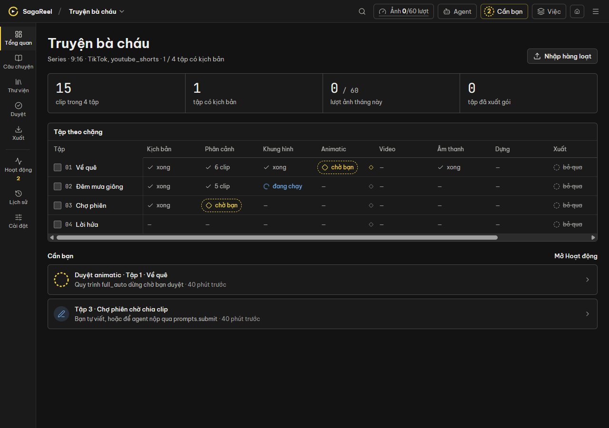
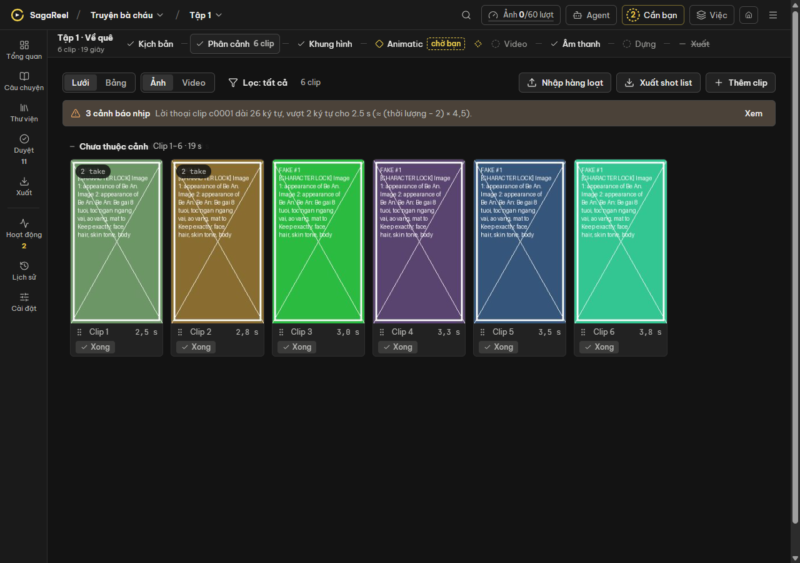
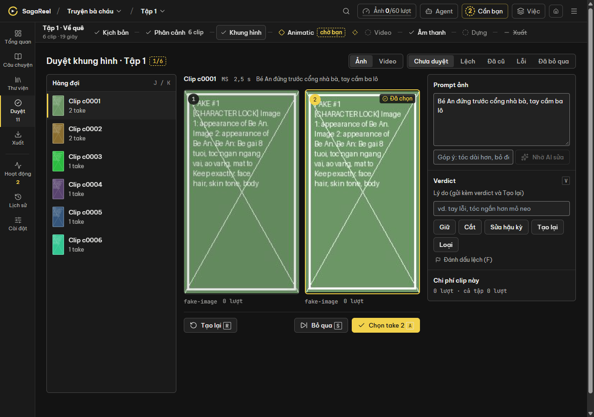
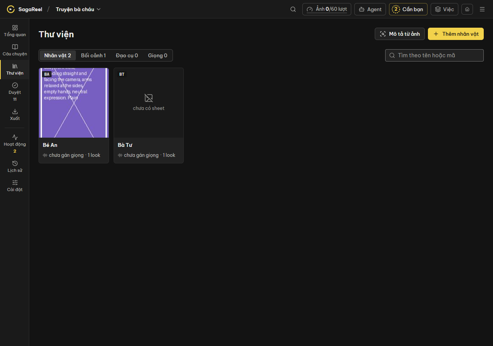
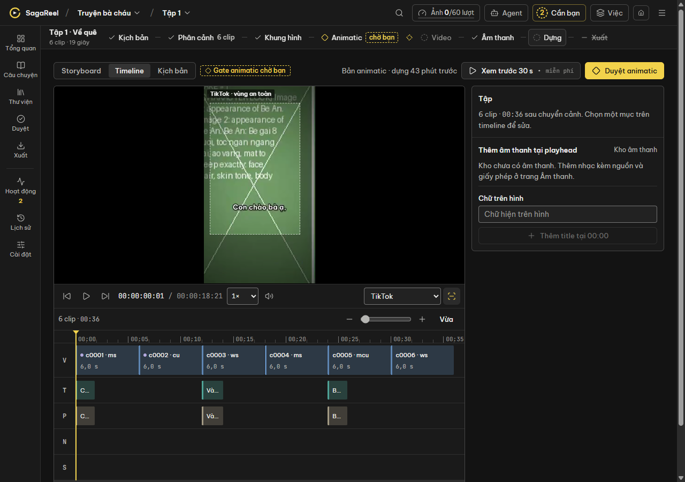

# SagaReel Studio

SagaReel Studio là studio dựng phim ngắn bằng AI chạy ngay trên máy Windows của bạn. Bạn đi từ một ý tưởng (hoặc một bộ
truyện, một kênh mẫu) tới video hoàn chỉnh theo một dây chuyền rõ ràng: viết câu chuyện, dựng thư viện nhân vật, tạo ảnh
và video, lồng tiếng, phụ đề, nhạc, dựng và xuất gói cho TikTok, Reels, Shorts hay YouTube. Ứng dụng gọi các dịch vụ AI
qua API (ảnh, video, giọng, LLM), nhớ nhân vật nhất quán qua hàng trăm tập, báo trước chi phí, và luôn dừng ở những điểm
cần bạn duyệt. Mọi thao tác đều hoàn tác được, và agent (Claude Code, Claude Desktop) có thể làm việc cùng bạn một cách an toàn.



## Tính năng

**Câu chuyện**
- Tạo dự án từ một ý tưởng, từ truyện dài (tự tách tập, có điểm treo cuối tập), từ video kênh mẫu, hoặc dự án trống.
- Story Bible (nhân vật, bối cảnh, giọng kể, "nhãn nhân thiết" khoá tính cách), dàn ý mùa/arc, kịch bản từng tập.
- Mỗi bước viết có thể do bạn tự làm, do LLM của app làm, hoặc nhờ agent ngoài làm.

**Thư viện nhân vật, bối cảnh, đạo cụ**
- Mỗi tài sản có mô tả khoá, nhiều look (trang phục, biểu cảm), ảnh mỏ neo và sheet nhiều góc.
- Lock word chèn nguyên văn vào mọi prompt; ma trận look tạo hàng loạt look con; kiểm tra lệch (drift) so với mỏ neo.

**Sản xuất tập**
- Bảng clip dạng lưới hoặc bảng, nhập hàng loạt từ dán dòng, CSV, XLSX, JSON, YAML hoặc thư mục ảnh.
- Trường shot (cỡ cảnh, góc máy, chuyển động máy...) và cảnh báo nhịp (đảo trục, lặp cỡ cảnh, thoại quá dài...).
- Duyệt take nhanh bằng bàn phím; tạo lại có ước tính chi phí; chi phí thật cộng dồn theo clip và theo tập.
- Animatic trước, video sau: xem bản nháp bằng ảnh tĩnh chuyển động + giọng + phụ đề trước khi tốn tiền tạo video.

**Âm thanh, dựng, xuất**
- Giọng đọc và lồng tiếng, phụ đề (kiểu viền, karaoke, phóng từ), thư viện nhạc/SFX có ghi giấy phép.
- Studio có player và timeline nhiều track; dựng tăng dần, có cache.
- Xuất gói theo nền tảng và ngôn ngữ: kiểm tra trước, metadata, ảnh bìa, chương, cờ "nội dung do AI tạo".

**Điều khiển và an toàn**
- Dây chuyền hai tầng (ma trận tập × chặng) và hộp "Cần bạn" gom mọi gate, lỗi và yêu cầu từ agent.
- Ước tính số ảnh/video trước khi chạy, lịch sử thay đổi theo từng người/agent, hoàn tác, thùng rác thay vì xoá hẳn.
- Truy cập từ xa có mật khẩu, vai trò chỉ xem và token API; agent qua MCP, CLI hoặc REST.

## Yêu cầu

- Windows 10/11.
- Python 3.11 do [uv](https://docs.astral.sh/uv/) quản lý (hoặc có sẵn `py -3.11`).
- Node.js và npm (để build giao diện lần đầu; bản build lưu ở `frontend/dist`).
- ffmpeg 8 có trong `PATH`.
- Tài khoản các nhà cung cấp bạn định dùng: ảnh (MaiVideo), video (GrokTele/MultiKit), LLM tương thích OpenAI. Giọng
  đọc mặc định là edge-tts, miễn phí và không cần khoá.

## Bắt đầu nhanh

1. Tạo file `.env.local` ở thư mục gốc (file này không đưa lên git) với các khoá bên dưới.
2. Chạy `run.bat`. Lần đầu nó tự tạo môi trường Python (`.venv`), cài thư viện, build giao diện, mở trình duyệt tại
   `http://127.0.0.1:8990` và khởi động máy chủ.
3. Vào Cài đặt > Kết nối để kiểm tra từng nhà cung cấp, rồi mở **Dự án** và tạo dự án đầu tiên. Xem
   [hướng dẫn sử dụng](docs/huong-dan-su-dung.md).

**Nạp kết nối từ `.env.local` (chỉ ở lần chạy đầu).** Khi khởi động lần đầu, app đọc `.env.local` và tạo các kết nối
chưa có. Các khoá được nhận (đặt giá trị của riêng bạn, không chia sẻ file này):

| Khoá | Dùng cho |
|---|---|
| `MAIVIDEO_API_KEY` (bắt buộc), `MAIVIDEO_BASE_URL`, `MAIVIDEO_MODEL` | Kết nối ảnh `maivideo` và model ảnh mặc định |
| `MULTIKIT_URL` (bắt buộc), `MULTIKIT_API_KEY`, `MULTIKIT_RESOLUTION`, `MULTIKIT_DURATION` | Kết nối video `groktele`, độ phân giải và thời lượng mặc định |
| `LLM_BASE_URL`, `LLM_MODEL` (cùng bắt buộc), `LLM_API_KEY` | Kết nối LLM `llm-local` (có vision) |

Kết nối giọng `edge-tts` luôn được tạo, không cần khoá. Khoá được lưu trong cơ sở dữ liệu và không bao giờ hiện lại
trong giao diện (chỉ thấy vài ký tự cuối). Thêm hoặc sửa kết nối sau này ở Cài đặt > Kết nối, hoặc chạy lại phần nhập
từ `.env.local` bằng thao tác `provider.import_env`.

Muốn dùng app từ điện thoại hoặc ngoài nhà: đọc [truy cập từ xa](docs/remote-access.md) trước, đừng mở cổng thẳng ra
Internet.

## Cấu trúc thư mục

```
run.bat                 Chạy ứng dụng (tạo môi trường, build giao diện, mở trình duyệt, chạy máy chủ)
backend/sagareel/       Máy chủ FastAPI: ops (sổ đăng ký thao tác), providers (adapter AI), render, db, cli
frontend/               Giao diện React + Vite (bản build ở frontend/dist)
mcp_server/             Máy chủ MCP cho Claude Code / Claude Desktop
.claude/skills/         Skill vận hành SagaReel cho agent (sagareel-operator)
docs/                   Tài liệu: hướng dẫn, truy cập từ xa, agent/MCP, nhà cung cấp, định dạng nhập, thiết kế
docs/screenshots/m8/    Ảnh chụp các màn hình
data/                   Dữ liệu chạy thật (cơ sở dữ liệu, media, cache, thùng rác); tạo khi chạy, không đưa lên git
```

## Tài liệu

- [Hướng dẫn sử dụng](docs/huong-dan-su-dung.md): đi theo dây chuyền sản xuất, từ tạo dự án tới xuất gói.
- [Truy cập từ xa](docs/remote-access.md): mở app ra ngoài một cách an toàn (mật khẩu, Cloudflare Tunnel, Tailscale).
- [Agent và MCP](docs/agents-va-mcp.md): kết nối Claude Code/Desktop, quy tắc chạy an toàn, file khai báo dự án.
- [Nhà cung cấp](docs/providers.md): các adapter ảnh/video/giọng/LLM, lỗi chuẩn (cho người phát triển).
- [Định dạng nhập clip hàng loạt](docs/import-format.md) và [file mẫu](docs/import-templates/clips.csv).
- [Kiến trúc UX](docs/design/ux-architecture.md), [thiết kế hệ thống](docs/superpowers/specs/2026-11-19-sagareel-studio-design.md),
  [phụ lục nghề làm phim](docs/superpowers/specs/2026-11-20-film-craft-addendum.md), [DESIGN.md](DESIGN.md).
- Dành cho agent: [AGENTS.md](AGENTS.md), [llms.txt](llms.txt), [mcp_server/README.md](mcp_server/README.md).

## Ảnh chụp

| Bảng clip của tập | Duyệt take |
|---|---|
|  |  |

| Thư viện | Studio |
|---|---|
|  |  |

Có đủ 21 màn hình ở 4 cỡ (375, 768, 1280, 1920) trong [docs/screenshots/m8/](docs/screenshots/m8/).

## Giấy phép

Chưa chọn giấy phép. Cho tới khi có quyết định, mọi quyền được bảo lưu. Font Be Vietnam Pro đi kèm theo giấy phép OFL
(xem `backend/sagareel/defaults/fonts/OFL.txt`).
