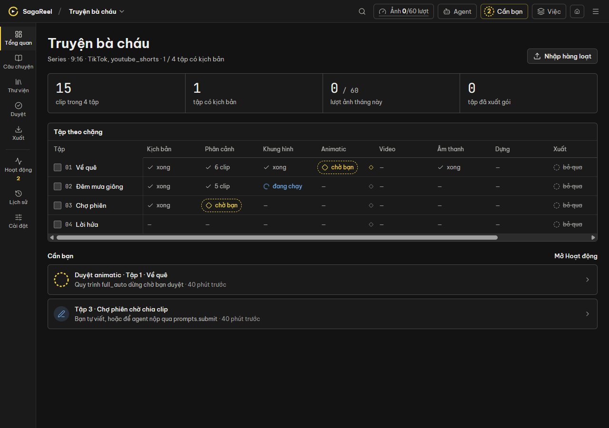
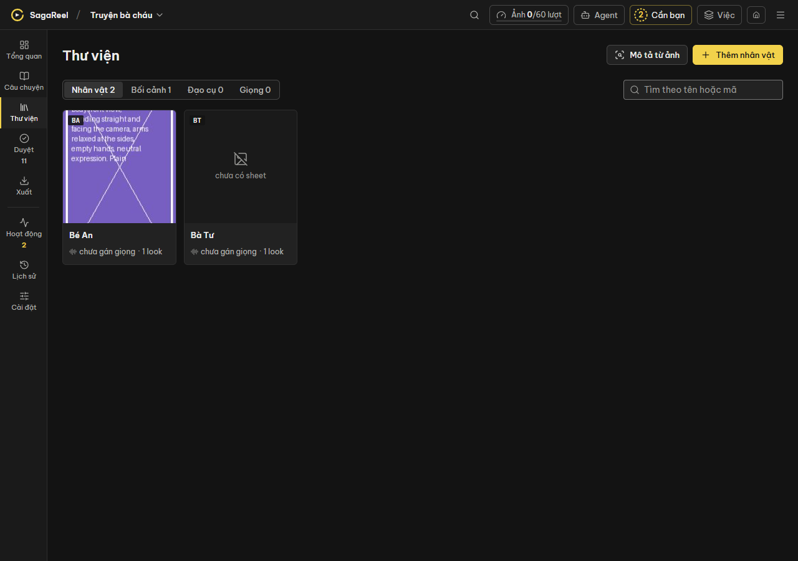
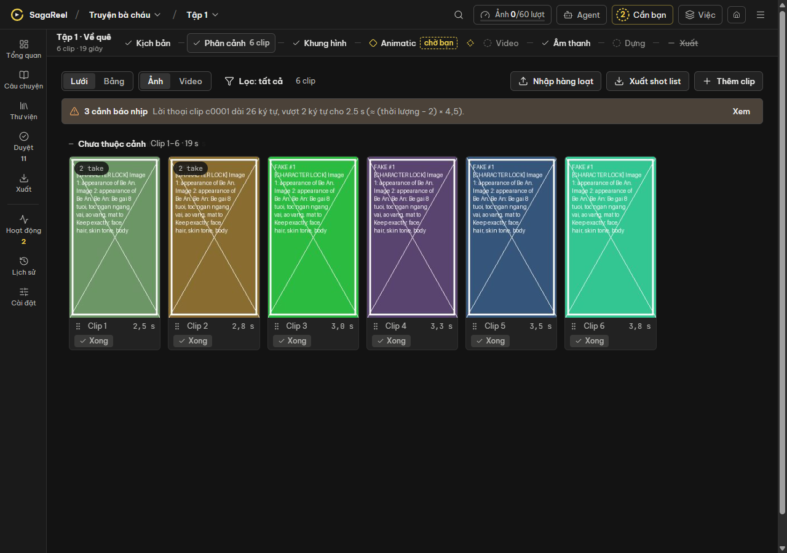
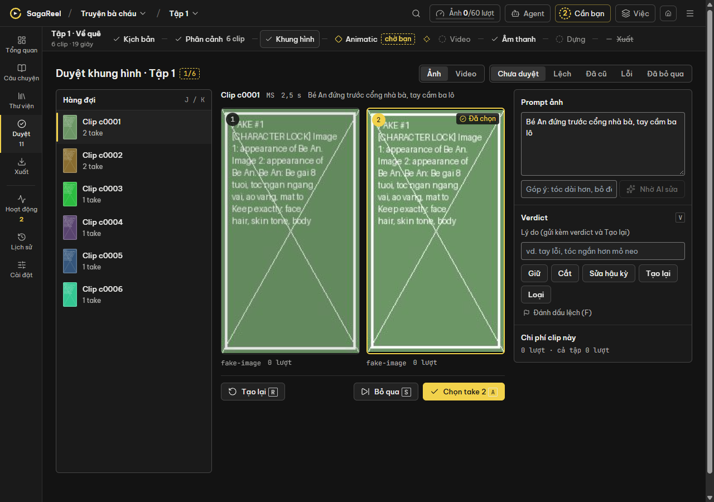
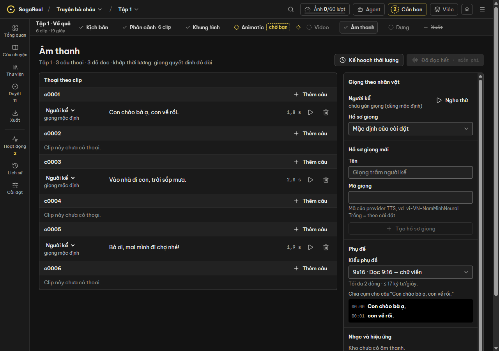
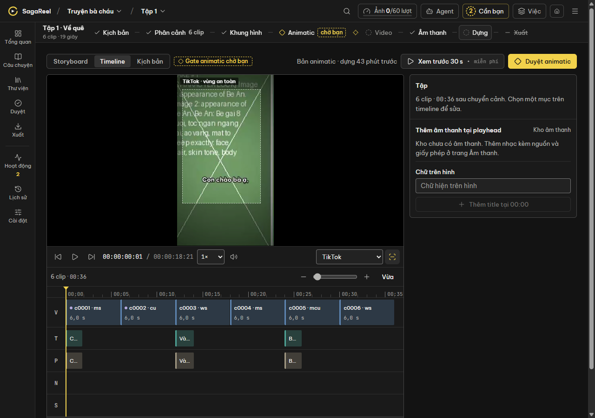
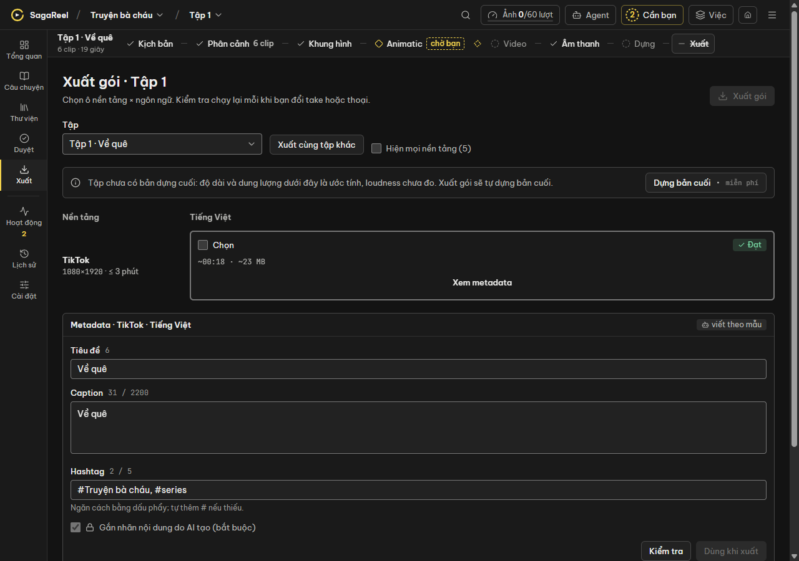

# Hướng dẫn sử dụng SagaReel Studio

Hướng dẫn này đi theo dây chuyền làm phim: tạo dự án, dựng thư viện, viết câu chuyện, sản xuất từng tập, duyệt, nghe
thử bản animatic, làm âm thanh, dựng và xuất gói. Cuối tài liệu có phím tắt tổng hợp và phần xử lý lỗi thường gặp.

Mở app bằng `run.bat` rồi vào `http://127.0.0.1:8990`. Cài đặt lần đầu xem [README](../README.md).

## 0. Làm quen trong 2 phút

**Hai tầng điều hướng.**

- **Tổng quan** của dự án là một ma trận: mỗi hàng là một tập, mỗi cột là một chặng (Kịch bản, Phân cảnh, Khung hình,
  Animatic, Video, Âm thanh, Dựng, Xuất). Nhìn là biết tập nào đang ở bước nào.
- Vào một tập, trên đầu mọi màn của tập có **thanh chặng** (cùng 8 chặng). Bấm chặng để mở đúng công cụ của chặng đó.

**Gate (điểm dừng chờ bạn).** Quy trình tự chạy nhưng dừng ở những chỗ bạn nên xem trước khi tốn tiền, ví dụ sau dàn ý,
sau ảnh, sau animatic, trước bản cuối. Gate đang chờ hiện ở ô viền vàng đứt "chờ bạn" và trong hộp **Cần bạn**.

**Chi phí luôn hiện trước.** Nút nào tốn lượt ảnh/video đều ghi số lượt, và có hộp ước tính trước khi chạy. Đồng hồ
"Ảnh 0/60 lượt" ở góc trên là ngân sách còn lại.



Rail bên trái (theo thứ tự làm phim): Tổng quan, Câu chuyện, Thư viện, Duyệt, Xuất; nhóm phụ: Hoạt động, Lịch sử, Cài
đặt dự án. Menu toàn cục: Dự án, Cần bạn, Mẫu, Cài đặt, Việc. Trên điện thoại là thanh dưới: Cần bạn, Duyệt, Tập, Việc,
Thêm.

## 1. Tạo dự án

Vào **Dự án**, bấm tạo mới và chọn một trong bốn lối:

| Lối | Dùng khi | Sau khi tạo |
|---|---|---|
| **Từ một ý tưởng** | Bạn chỉ có một ý | Viết Bible, dàn ý, kịch bản, dừng ở gate đầu tiên |
| **Chuyển thể truyện dài** | Có sẵn truyện (dán hoặc tải) | Tự tách tập, mỗi tập có điểm treo cuối; mở tab Chuyển thể |
| **Từ kênh mẫu** | Muốn bắt chước nhịp và phong cách một kênh | Phân tích video bạn tải lên; mở tab Kênh |
| **Dự án trống** | Đã có clip/ảnh, tự dựng | Mở Tổng quan, tự thêm clip hoặc nhập bảng |

Form tạo gồm tên, **thể loại**, tỉ lệ khung hình và nền tảng (gợi ý theo thể loại). Thể loại có sẵn: Phim bộ (serial,
kết bằng điểm treo), Series, Thuyết minh, Montage (kết lặp), Storyboard. Mỗi thể loại đặt sẵn độ dài tập, số clip, kiểu
chuyển cảnh, mức nhạc nền; xem và sửa ở mục **Mẫu** (phần 13).

Nút **Ước tính chi phí** (nếu có) cho biết trước số lượt LLM, ảnh sheet, ảnh khung hình. Video luôn để ngỏ vì nằm sau gate.

Cài đặt dự án (style, ngôn ngữ, nền tảng, ngân sách, quy trình) ở **Cài đặt** trong rail dự án.

## 2. Thư viện: nhân vật, bối cảnh, đạo cụ

Thư viện là nơi giữ cho nhân vật trông giống nhau từ tập 1 tới tập 300.



- **Tài sản**: nhân vật, bối cảnh, đạo cụ (thêm loại mới được). Có thể nhờ LLM đọc một ảnh và gợi ý mô tả.
- **Mô tả khoá**: phần mô tả ngoại hình đã chốt. Prompt dùng đúng chữ này nên LLM không "sáng tác lại" nhân vật.
- **Look**: một bộ trang phục/biểu cảm của nhân vật. Mỗi look có một ảnh **mỏ neo** và ảnh tham chiếu. Nên giữ tối đa 6
  ảnh tham chiếu mỗi look; vượt thì app cảnh báo (quá nhiều ref làm model rối).
- **Lock word**: cụm ngắn kiểu "màu + chất liệu + vật" (ví dụ "áo dài đỏ gấm, nón lá") được chèn nguyên văn vào mọi
  prompt có look đó. Dùng cho chi tiết hay bị trôi.
- **Sheet**: tạo ảnh nhân vật nhiều góc (chính diện, 3/4, nghiêng, sau, cận). Mỏ neo chính diện được tạo từ chữ; các
  góc khác tạo từ mỏ neo để giữ nhất quán. Xong, bạn chọn take đẹp nhất cho từng góc; chỗ chờ chọn hiện ở Cần bạn.
- **Ma trận look**: chọn nhiều trang phục × nhiều biểu cảm, app tạo hàng loạt look con có tên (có ước tính giá trước).
- **Kiểm tra lệch (drift)**: LLM nhìn ảnh take và so với mỏ neo theo bảng cố định (mặt, tóc, trang phục, màu, đạo cụ,
  tay, chữ lạ). Điểm dưới 70 thì clip bị gắn cờ "lệch". Lọc **Lệch** trong màn Duyệt để xem cả loạt.
- **Sửa nhân vật bị lệch**: mở look, chỉnh lock word hoặc nét cần giữ. Các clip bị ảnh hưởng đánh dấu **đã cũ** (Tổng
  quan hiện "đã cũ n" ở chặng Khung hình) để bạn tạo lại đúng những clip đó.
- **Giọng** và **Âm thanh** của dự án cũng nằm ở Thư viện (phần 7).

## 3. Câu chuyện

Màn **Câu chuyện** gồm các tab: Bible, dàn ý, chuyển thể, kênh mẫu, clone.

- **Story Bible**: nhân vật, thế giới, giọng kể. Mục mới viết ở trạng thái chờ xác nhận; bạn xác nhận, sửa, hoặc khoá
  "nhãn nhân thiết" (tính cách cố định) để LLM không làm trôi nhân vật qua các tập. Thư viện tự gợi ý tài sản từ Bible.
- **Dàn ý** mùa/arc và danh sách tập.
- **Kịch bản** từng tập ở màn riêng (vào từ chặng Kịch bản); chữ chạy dần khi LLM viết. Bộ nhớ truyện tóm tắt các tập
  trước để tập sau nhất quán.
- **Chuyển thể truyện**: dán hoặc tải truyện, chọn độ dài mục tiêu, app tách tập theo độ dài và đặt điểm treo cuối tập.
  Mặc định khoảng 40 ký tự truyện ứng với 1 giây phim.
- **Ai viết?** Với từng bước (Bible, dàn ý, kịch bản, chia clip, prompt ảnh, prompt chuyển động, thoại) bạn chọn: tự viết,
  để LLM của app viết, hoặc nhờ agent ngoài (xem [agent và MCP](agents-va-mcp.md)). Chọn "tự viết" thì bước đó thành thẻ
  "chờ bạn" trong Cần bạn.

## 4. Tập và bảng clip

Mỗi tập có **bảng clip**: lưới ảnh hoặc dạng bảng (nút Lưới/Bảng), xem theo Ảnh hoặc Video.



- Thêm clip, kéo thả đổi thứ tự (`Alt ↑/↓` dời bằng phím), chia clip, nhân bản. Clip gom theo **cảnh**.
- **Xuất shot list** (CSV/XLSX) ở nút trên bảng.
- **Trường shot** của clip: cỡ cảnh (toàn, trung, cận, đặc tả, chèn...), góc máy, chuyển động máy, ống kính, bố cục,
  hướng nhìn, hướng chuyển động trên màn hình. Đây là nguồn để app cảnh báo nhịp.
- **Engine** của clip: video AI, ảnh tĩnh chuyển động (không tốn lượt video), hoặc code animation. Nối clip theo ba kiểu:
  cắt, mờ, hoặc nối tiếp (dùng khung cuối clip trước).
- **Prompt**: chế độ *synced* (app ghép nhân vật, bối cảnh, lock word vào prompt) hoặc *verbatim* (gửi nguyên văn). Có
  nút xem trước prompt cuối cùng trước khi tạo.
- **Cảnh báo nhịp** (thanh vàng phía trên, không chặn bạn):
  - đảo trục (axis flip) và đổi hướng chuyển động màn hình;
  - lặp cùng cỡ cảnh nhiều lần;
  - chuỗi hơn 3 clip "nối tiếp" liền nhau (gợi ý nạp lại ảnh gốc để tránh trôi hình);
  - thoại quá dài so với thời lượng clip: số ký tự vượt (thời lượng − 2 giây) × 4,5.

### Nhập hàng loạt

Bấm **Nhập hàng loạt** (hoặc vào từ menu Thêm trên điện thoại). Luôn có hai bước: **xem trước** (không ghi gì, báo lỗi
từng dòng) rồi **áp dụng** (tạo tất cả một lần, hoàn tác bằng một thao tác).

Nguồn nhập: dán từng dòng, CSV, XLSX, JSON, YAML hoặc một thư mục ảnh (mỗi ảnh một clip). Tên cột không phân biệt hoa
thường hay dấu (`Cảnh`, `canh`, `Scene` đều được). Cách viết cột, ví dụ dán dòng và mã lỗi: xem
[định dạng nhập](import-format.md); file mẫu ở `docs/import-templates/`.

Mẹo dán dòng:

```
Cảnh 1: Quán cà phê đêm mưa
Cận cảnh An ngồi bên cửa sổ, ôm ly cà phê nguội
AN: Anh ấy lại không đến.
```

Dòng thường là một clip, `Cảnh X: tên` mở cảnh mới, `MÃ: câu` là thoại gắn vào clip ngay trước. Mã nhân vật chưa có trong
thư viện sẽ được liệt kê và có thể tạo luôn khi áp dụng. File lớn (tối đa 20 MB cho file bảng) tải lên chia khối, nối lại được.

## 5. Duyệt

Màn **Duyệt** là nơi bạn chọn take đẹp nhất cho từng clip, nhanh bằng bàn phím. Mở từ rail hoặc từ thanh chặng (Khung
hình, Video); có thể lọc theo tập, theo phần Ảnh/Video, và theo Lệch, Cũ, Lỗi, Bỏ qua.



| Phím | Việc |
|---|---|
| `1` – `9` | Chọn take |
| `A` | Duyệt take đang xem và sang clip kế |
| `R` / `Shift R` | Tạo lại / sửa prompt rồi tạo lại |
| `S` | Bỏ qua |
| `J` `K` (hoặc `←` `→`) | Clip trước / kế |
| `Shift J` `Shift K` | Clip lỗi hoặc cũ trước / kế |
| `↑` `↓` | Take trước / kế |
| `E` | Sửa prompt |
| `V` | Menu verdict (giữ, cắt, sửa hậu kỳ, tạo lại, loại) |
| `C` | So sánh cạnh nhau |
| `F` | Đánh dấu lệch |
| `Space` | Phát / dừng |
| `Ctrl Z` | Hoàn tác lần chọn |
| `Esc` | Thoát |

Phím đơn chữ không chạy khi bạn đang gõ trong ô nhập. Tạo lại dưới ngưỡng nhỏ (mặc định dưới 5 lượt) chạy ngay kèm thông
báo "Hoàn tác"; lớn hơn thì hỏi xác nhận. Sau hai lần tạo lại cùng một lý do, app gợi ý đổi cách (sửa prompt, đổi ảnh
tham chiếu, đổi engine) thay vì tạo lại tiếp. Chi phí thật (mọi lần thử) cộng dồn trên từng clip và từng tập.

Hết hàng đợi, màn tổng kết cho biết bao nhiêu clip đã duyệt, tạo lại, bỏ qua; có nút duyệt lại các clip bỏ qua.

## 6. Animatic trước, video sau (tiết kiệm)

Video AI là bước tốn nhất, nên quy trình mặc định có **bản animatic** trước: ảnh đã duyệt chuyển động nhẹ (ảnh tĩnh
chuyển động), ghép giọng đọc và phụ đề thô, dựng nháp nhanh. Bạn xem trọn tập, sửa nhịp, thoại, thứ tự ngay khi còn rẻ.
Chỉ khi hài lòng bạn duyệt gate **Animatic** để app mới bắt đầu tạo video.

- Xem animatic ở Studio (chặng 4).
- Bản animatic không tốn lượt video; chỉ tốn thời gian dựng.
- Gate "thử một tập đầu" (pilot) cho phép chạy thử 2 clip hoặc một tập trước khi chạy cả lô.

## 7. Âm thanh

Màn **Âm thanh của tập** (chặng 6) gom giọng, thoại, phụ đề, nhạc.



- **Giọng theo nhân vật**: tạo hồ sơ giọng (nhà cung cấp, mã giọng như `vi-VN-NamMinhNeural`, tốc độ, cao độ), nghe thử một
  câu, gắn cho nhân vật. Mặc định giọng `vi-VN-HoaiMyNeural` (edge-tts, miễn phí).
- **Thoại**: sửa theo clip, mỗi câu có người nói và cảm xúc; thêm bản dịch cho từng ngôn ngữ. Người kể là `NR`.
- **Lồng tiếng**: bấm tạo giọng cho cả tập (hộp ước tính cho biết số câu cần đọc; câu đã có trong cache không tính lại).
  Muốn thêm ngôn ngữ, thêm vào danh sách ngôn ngữ của dự án, điền bản dịch rồi tạo giọng cho ngôn ngữ đó.
- **Khớp thời lượng giọng với clip**: chế độ mặc định "giọng quyết định" (clip video chọn 6/10/15 giây sao cho đủ chứa giọng).
  Chế độ khác: tăng tốc giọng nhẹ (tối đa 1,25 lần, cảnh báo nếu cần hơn) hoặc không tự khớp.
- **Độ to**: thoại chuẩn hoá khoảng −16 LUFS, bản trộn cuối −14 LUFS (nền tảng có thể đặt mức riêng). Nhạc nền tự hạ khi có
  thoại (ducking).
- **Âm gốc của video AI** (nếu có) mặc định chỉ để làm nền nhỏ, cho tới khi bạn xác nhận chất lượng tiếng Việt của nó.
- **Phụ đề**: ba preset (`9x16`, `9x16_box`, `16x9`) và ba kiểu hiện chữ (viền, karaoke tô dần, phóng từ đang đọc). Font
  Be Vietnam Pro đi kèm nên dấu tiếng Việt hiển thị đúng. Phụ đề tối đa 2 dòng, ngắt theo độ rộng thật.
- **Nhạc và hiệu ứng** (kho nhạc, SFX, âm nền): khi thêm bạn phải ghi **nguồn** và **giấy phép**. Không rõ thì ghi
  `unknown`; app sẽ cảnh báo lúc xuất gói. Nhạc gắn theo clip nên đổi độ dài clip thì nhạc đi theo.

## 8. Studio

Studio (chặng 7, và xem animatic) có player, timeline 5 track (video, thoại, nhạc, SFX, tiêu đề) và bảng chi tiết.



- Dựng nháp, hoặc xem thử N giây đầu để kiểm tra nhanh. Ước tính thời gian và dung lượng đĩa trước khi dựng bản cuối.
- Chọn clip, tạo lại ngay trong Studio, cắt clip tại vị trí đang đứng (`Ctrl B`).
- Bật **vùng an toàn** (`G`) để kiểm tra chữ và hình có bị giao diện nền tảng che không.
- Dựng tăng dần theo khối nên sửa một clip chỉ dựng lại phần liên quan. Cache dựng có trần dung lượng (phần 12).
- Phím Studio: `Space` phát/dừng, `←` `→` lùi/tiến từng khung (`Shift` = 1 giây), `J` lùi 2 giây, `K` về tốc độ thường, `L`
  tua nhanh (nhấn nhiều lần tăng tốc), `G` vùng an toàn, `+` `−` phóng to/thu nhỏ timeline, `\` vừa khít, `Delete` xoá mục
  đã chọn, `Ctrl B` cắt, `Ctrl Enter` tạo lại clip đang chọn (có ước tính).

Trong Studio phím `G` là vùng an toàn, nên chuỗi `G` rồi chữ để chuyển màn không dùng được; dùng `Ctrl K`.

## 9. Xuất gói

Màn **Xuất** là ma trận **tập × nền tảng × ngôn ngữ**.



Nền tảng có sẵn: TikTok, Facebook Reels, Facebook video (4:5), YouTube Shorts, YouTube dài. Mỗi nền tảng có sẵn khung hình,
mã hoá, giới hạn độ dài và dung lượng, vùng an toàn.

1. Chọn ô (tập, nền tảng, ngôn ngữ). App chạy **kiểm tra** trước, báo lỗi và cảnh báo về: độ dài, dung lượng, độ to âm
   thanh, phụ đề rơi ra ngoài vùng an toàn, metadata vượt giới hạn ký tự, nhạc thiếu giấy phép. Lỗi nên sửa trước khi xuất.
2. Xem và sửa **metadata** (tiêu đề, mô tả, hashtag) ở ngăn bên, riêng cho từng nền tảng và ngôn ngữ.
3. Chọn nhiều ô rồi xuất; mỗi ô là một **gói** gồm video đã mã hoá theo nền tảng, ảnh bìa, phụ đề, chương (YouTube), file
   manifest và metadata. Gói đánh dấu nội dung do AI tạo, kèm nguồn và giấy phép nhạc.
4. Tập dài vượt giới hạn nền tảng có thể cắt thành nhiều phần.
5. Tải gói về, hoặc mở thư mục gói trên máy chạy app.

Ô ngôn ngữ chưa có bản dịch thoại sẽ báo thiếu và đưa bạn tới phần dịch và lồng tiếng. App **không tự đăng** lên nền tảng;
bạn tự tải lên.

## 10. Cần bạn, gate và agent

**Cần bạn** (menu toàn cục và trên điện thoại là màn mở đầu) là hộp thư mọi việc đang chờ quyết định: gate, lỗi cần xử
lý, nhân vật lệch, việc bị giữ vì vượt ngân sách, bước "chờ bạn tự viết" và yêu cầu từ agent.

- **Thẻ gate** ghi rõ **giá của bước kế** và ngân sách còn lại, vì duyệt gate nghĩa là cho phép tiêu tiền. Có hai nút:
  **Duyệt và chạy tiếp** hoặc **Trả lại** (kèm góp ý; bước tương ứng làm lại theo góp ý).
- Quy trình (gate nào bật) là một preset **quy trình** ở Mẫu. Có sẵn: *Tự động* (chỉ dừng duyệt animatic), *Bảng phân cảnh
  trước* (dừng sau dàn ý, sau ảnh, sau animatic, trước bản cuối), *Phim bộ theo lô* (viết tuần tự, thử tập đầu rồi chạy lô).
  Tắt hết gate là tự động hoàn toàn.
- **Chạy tới gate kế tiếp**: ở Tổng quan chọn nhiều tập (Shift-click), chạy chung; hộp ước tính gom theo chặng và cảnh báo
  nếu vượt ngân sách.
- **Agent**: chip "Agent" ở thanh trên cho biết có agent đang làm. Panel **Hoạt động** (phím `.`) hiện mỗi agent đang làm gì,
  thay đổi gần nhất, chi phí đã tiêu, nút **tạm dừng agent**. Agent không bao giờ tự duyệt gate thay bạn. Cách kết nối:
  [agent và MCP](agents-va-mcp.md).
- **Việc** (Jobs): mọi việc chạy nền (tạo ảnh, video, giọng, dựng, xuất). Xem nhật ký, huỷ, thử lại (thử lại cũng tốn
  lượt), tạm dừng cả hàng đợi.

## 11. Lịch sử và hoàn tác

Mọi thay đổi, của bạn, của LLM hay của agent, được ghi thành một **change set** có tên người làm.

- `Ctrl Z` / `Ctrl Shift Z`: hoàn tác / làm lại thay đổi mới nhất **của chính bạn** trong dự án.
- Màn **Lịch sử**: xem danh sách thay đổi, hoàn tác một thay đổi bất kỳ (kể cả của agent), hoặc khôi phục từng đối tượng
  về một phiên bản cũ.
- Nếu đối tượng đã bị người khác sửa tiếp sau đó, app từ chối hoàn tác (xung đột) và liệt kê đối tượng, cho bạn chọn khôi
  phục từng cái; không bao giờ ghi đè ngầm.
- Nhập hàng loạt, áp file khai báo, xoá đều hoàn tác được bằng một thao tác. Riêng "xoá hẳn thùng rác" thì không.

## 12. Ngân sách, lưu trữ và thùng rác

**Ngân sách** (Cài đặt > Ngân sách): trần số ảnh và số video được tạo (0 = không giới hạn). Mặc định 60 ảnh và 20 video;
khi nạp từ `.env.local`, video GrokTele được đặt không giới hạn. Kết nối giả (dùng để thử) không tính. Việc vượt ngân sách
dừng ở trạng thái "chờ, vượt ngân sách" và hiện trong Cần bạn; bạn nâng trần hoặc huỷ việc, không có đường lách. Cài đặt
"không hỏi lại dưới N lượt" (mặc định 5) quyết định khi nào app hỏi xác nhận.

**Lưu trữ** (Cài đặt > Lưu trữ): theo dõi dung lượng ổ đĩa.
- *Dọn take cũ*: chuyển file gốc của take không được chọn vào **thùng rác** (`data/trash`), không xoá hẳn. Có xem trước.
- *Thùng rác*: khôi phục file về chỗ cũ, hoặc xoá hẳn (không quay lại được, cần xác nhận). Gợi ý giữ 30 ngày.
- *Cache dựng*: có trần mặc định 30 GB và luôn chừa tối thiểu 10 GB ổ trống; app tự dọn phần ít dùng nhất. Xoá cache
  chỉ làm lần dựng sau lâu hơn, không mất dữ liệu.

**Xoá** dự án, tập, tài sản, look, preset luôn hai bước: xem tác động trước, rồi xác nhận. Đối tượng bị xoá mềm.

## Luồng (số việc chạy cùng lúc)

**Luồng** (Cài đặt > Luồng) đặt số việc được chạy cùng lúc cho **mỗi loại provider**, tính chung trên toàn app:
Ảnh, Video, LLM, Giọng đọc, Nhận dạng giọng và Dựng phim (ffmpeg). Mặc định 2 · 2 · 3 · 2 · 1 · 1, chọn từ 1 đến 20.

- Đây là **trần cứng** cộng mọi kết nối cùng loại: Video = 1 với hai kết nối video thì không bao giờ có hai video tạo
  cùng lúc. Trần riêng của từng kết nối (Sửa kết nối > Số việc song song) vẫn áp dụng bên trong.
- Bấm +/− là **áp dụng ngay**: việc đang chờ được nhận liền nếu còn chỗ, không cần khởi động lại. Hạ trần **không dừng**
  việc đang chạy — chúng làm nốt, app chỉ ngừng nhận việc mới tới khi số đang chạy xuống dưới trần (trang hiện ô sọc
  cho phần vượt). Mỗi lần đổi có Hoàn tác.
- Viết truyện và dịch lồng tiếng tính vào luồng LLM; dựng tập, ghép âm thanh, xuất gói tính vào Dựng phim.
- Trang Việc có dòng tóm tắt "Luồng: Video 2/2 +3 chờ…"; bấm vào để sang trang Luồng.
- Agent: `queue.concurrency` (xem trần + số đang chạy/chờ từng loại và từng kết nối), `queue.set_concurrency`
  (`{"values": {"video": 3}}`).

## 13. Mẫu (preset)

Màn **Mẫu** chứa các preset dùng chung, đều sửa được (bản cài sẵn có nút khôi phục):
- **Thể loại** (độ dài tập, số clip, chuyển cảnh, mức nhạc, kiểu kết, hook 3 giây đầu);
- **Quy trình** (bước nào chạy, gate nào bật);
- **Nền tảng** (thông số xuất);
- **Phụ đề**, **chuyển cảnh**, **chuyển động ảnh tĩnh** (zoom, pan, grain...);
- **Prompt** (mẫu prompt ảnh, chuyển động, sheet) và skill vận hành của agent.

Cài đặt theo tầng: mặc định, toàn cục, preset, dự án, tập, cảnh, clip, lần chạy; tầng sau thắng tầng trước. Chỗ nào có
nhãn nguồn bạn thấy giá trị đang đến từ tầng nào.

## 14. Phím tắt tổng hợp

| Phím | Việc |
|---|---|
| `Ctrl K` | Bảng lệnh: tìm trang hoặc tập (gõ không dấu cũng khớp) |
| `?` | Bảng phím |
| `.` | Mở/đóng panel Hoạt động |
| `G` rồi `O` `C` `L` `D` `X` `H` | Tổng quan, Câu chuyện, Thư viện, Duyệt, Xuất, Hoạt động |
| `G` rồi `T` / `I` | Tập (ma trận) / Cần bạn |
| `Esc` | Đóng lớp trên cùng |
| `Ctrl Z` / `Ctrl Shift Z` | Hoàn tác / làm lại |
| `Alt 1` … `Alt 8` | Trong tập: mở chặng 1 đến 8 |
| `[` `]` | Trong tập: tập trước / kế |
| `↑` `↓`, `Enter`, `Space`, `F2` | Bảng clip: hàng, mở chi tiết, chọn, sửa ô |
| `Ctrl Enter` | Bảng clip: tạo lại phần đang xem |
| `Alt ↑` `Alt ↓` | Bảng clip: dời clip |

Phím của Duyệt ở phần 5, của Studio ở phần 8.

## 15. Câu hỏi thường gặp và xử lý lỗi

**GrokTele chưa mở / video không tạo được (`provider_unavailable`).** Dịch vụ video yêu cầu bạn đã đăng nhập tài khoản
trong phòng GrokTele. Mở GrokTele, đăng nhập, đảm bảo tài khoản đang hoạt động, rồi vào Cài đặt > Kết nối kiểm tra lại. Các
việc video đang đợi sẽ hiện trong Cần bạn; sau khi mở lại bạn bấm thử lại. Các bước chưa cần video (ảnh, âm thanh,
animatic) vẫn làm được bình thường.

**MaiVideo báo hạn mức còn 0 nhưng vẫn tạo được.** Với gói của bạn con số hạn mức tháng trả về bằng 0 là vô hại: ảnh vẫn
tạo bình thường. Đừng dừng việc vì cảnh báo này; hãy theo dõi đồng hồ ngân sách của chính SagaReel (mặc định 60 ảnh).

**Ảnh MaiVideo mất rất lâu (có khi hơn 10 phút).** Bình thường với model ảnh chất lượng cao; app chờ tới 30 phút mỗi
job. Đừng huỷ giữa chừng: huỷ không chắc hoàn lại lượt. Nếu job báo "không chắc MaiVideo đã nhận" thì xem ở Cần bạn trước khi gửi lại (gửi lại tốn thêm lượt).

**edge-tts báo `NoAudioReceived`.** Đây là lỗi chập chờn phía Microsoft. App tự thử lại và lưu cache các câu đã đọc được,
bạn không cần làm gì; nếu vẫn lỗi sau vài lần, chờ vài phút rồi tạo giọng lại (các câu đã xong không bị đọc lại).

**Lỗi 401/403 từ nhà cung cấp.** Khoá API sai hoặc hết hạn. Cập nhật ở Cài đặt > Kết nối.

**Nội dung bị từ chối (moderation).** Sửa prompt của clip cho nhẹ đi rồi tạo lại; đừng thử lại y nguyên.

**Việc bị "vượt ngân sách".** Vào Cài đặt > Ngân sách nâng trần, hoặc huỷ các việc đang giữ.

**Việc "bị ngắt" sau khi tắt/mở lại app.** App nối tiếp việc theo mã bên nhà cung cấp, không tạo trùng; mở Việc hoặc Cần bạn để xem.

**"Đã cũ" (stale) ở một chặng.** Bạn sửa ngược dòng (mô tả nhân vật, prompt) nên kết quả phía sau không còn khớp. Chọn tạo lại
đúng các clip đã cũ.

**Hai người cùng sửa (người và agent): "đã tải bản mới".** Trường quay về giá trị mới nhất; chữ bạn đang gõ nằm ở khay nháp.

**Dựng chậm / hết ổ đĩa.** Dọn cache dựng và take cũ ở Cài đặt > Lưu trữ.

**Quên mật khẩu khi dùng từ xa.** Xem [truy cập từ xa](remote-access.md), mục đặt lại mật khẩu ngoại tuyến.
